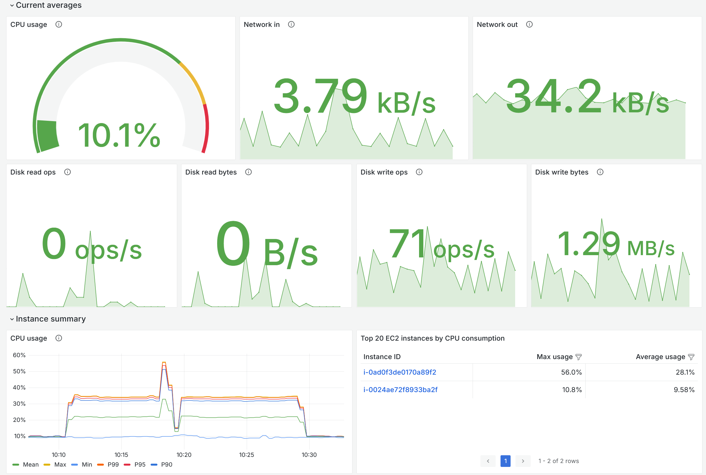

# C# server SDK for Amazon GameLift Servers

## Documentation

You can find the official Amazon GameLift Servers documentation [here](https://docs.aws.amazon.com/gamelift/).

## Building the SDK

### Instructions

Steps:

1. Open `GameLiftServerSDK.sln` solution in [Visual Studio](https://visualstudio.microsoft.com/) or [Rider](https://www.jetbrains.com/rider/)
2. Restore NuGet packages
3. Configure **Target Framework** to `.NET 10`, `.NET 8`, `.NET 6`, or `.NET 4.6.2`
4. Configure **MSBuild version** to 17.0 if the **Target Framework** is `.NET 6`, 17.8 for `.NET 8`, or 18.0 for `.NET 10`
5. Configure **Platform** to specify the processor architecture you want to build your game server for. Set to `x64` for Intel processors, or `arm64` for Arm-based processors
6. Build project
7. Locate the build artifacts in `bin/` directory

### Configuring the C# linter

Each linter option is specified by a series of letters and numbers, e.g., S5753. You can disable options globally in `GameLiftServerSDK.ruleset`, or disable them locally using:

```csharp
#pragma warning disable S1147  // Disables S1147 until it is re-enabled using 'restore' after
    Environment.Exit(-1);
#pragma warning restore S1147
```

If you wish to know more about a SonarLint option, please look it up here: https://rules.sonarsource.com/csharp/RSPEC-6354. Note that you should replace "6354" with the number after the "S" of the option you want to search. For example, option "S1147" would be [RSPEC-1147](https://rules.sonarsource.com/csharp/RSPEC-1147).

## Usage

### Using the SDK in a C# console application

Steps:

1. Create a new console application project
2. Add the build artifact `GameLiftServerSDK.dll` to the project
3. To build successfully, you might need to include the dependent DLLs or manually restore the dependencies in the NuGet package manager

Below is a console application that showcases a simple game server initialization with Amazon GameLift Servers：

```csharp
using Aws.GameLift.Server;
using Aws.GameLift.Server.Model;

public class Program
{
    public static void Main(string[] args)
    {
        var server = new GameLiftServerExampleBehavior();
        server.Start();
    }
}

public class GameLiftServerExampleBehavior
{
    //This is an example of a simple integration with the server SDK that will make game server processes go active on Amazon GameLift Servers!
    public void Start()
    {
        //Identify port number (hard coded here for simplicity) the game server is listening on for player connections
        var listeningPort = 7777;

        //WebSocketUrl from RegisterHost call
        var webSocketUrl = "wss://us-west-2.api.amazongamelift.com";

        //Unique identifier for this process
        var processId = "myProcess";

        //Unique identifier for your host that this process belongs to
        var hostId = "myHost";

        //Unique identifier for your fleet that this host belongs to
        var fleetId = "myFleet";

        //Authentication token for this host process.
        var authToken = "myAuthToken";

        ServerParameters serverParameters = new ServerParameters(
            webSocketUrl,
            processId,
            hostId,
            fleetId,
            authToken);

        //InitSDK reads server parameters from the host environment to set up communication between the server and the Amazon GameLift Servers service.
        var initSDKOutcome = GameLiftServerAPI.InitSDK(serverParameters);
        if (initSDKOutcome.Success)
        {
            ProcessParameters processParameters = new ProcessParameters(
                (GameSession gameSession) =>
                {
                    // IMPORTANT: If you are using the MetricsManager, call OnGameSessionStart here
                    // to tag subsequent metrics with this session ID.
                    // Assume you have an instance named 'metricsManager':
                    // metricsManager.OnGameSessionStart(gameSession);

                    //When a game session is created, Amazon GameLift Servers sends an activation request to the game server and passes along the game session object containing game properties and other settings.
                    //Here is where a game server should take action based on the game session object.
                    //Once the game server is ready to receive incoming player connections, it should invoke GameLiftServerAPI.ActivateGameSession()
                    GameLiftServerAPI.ActivateGameSession();
                },
                (UpdateGameSession updateGameSession) =>
                {
                    //When a game session is updated (e.g. by FlexMatch backfill), Amazon GameLift Servers sends a request to the game
                    //server containing the updated game session object.  The game server can then examine the provided
                    //matchmakerData and handle new incoming players appropriately.
                    //updateReason is the reason this update is being supplied.
                },
                () =>
                {
                    //OnProcessTerminate callback. Amazon GameLift Servers will invoke this callback before shutting down an instance hosting this game server.
                    //It gives this game server a chance to save its state, communicate with services, etc., before being shut down.
                    //In this case, we simply tell Amazon GameLift Servers we are indeed going to shutdown.
                    GameLiftServerAPI.ProcessEnding();
                },
                () =>
                {
                    //This is the HealthCheck callback.
                    //Amazon GameLift Servers will invoke this callback every 60 seconds or so.
                    //Here, a game server might want to check the health of dependencies and such.
                    //Simply return true if healthy, false otherwise.
                    //The game server has 60 seconds to respond with its health status. Amazon GameLift Servers will default to 'false' if the game server doesn't respond in time.
                    //In this case, we're always healthy!
                    return true;
                },
                listeningPort, //This game server tells Amazon GameLift Servers that it will listen on port 7777 for incoming player connections.
                new LogParameters(new List<string>()
                {
                    //Here, the game server tells Amazon GameLift Servers what set of files to upload when the game session ends.
                    //Amazon GameLift Servers will upload everything specified here for the developers to fetch later.
                    "/local/game/logs/myserver.log"
                }));

            //Calling ProcessReady tells Amazon GameLift Servers this game server is ready to receive incoming game sessions!
            var processReadyOutcome = GameLiftServerAPI.ProcessReady(processParameters);
            if (processReadyOutcome.Success)
            {
                Console.WriteLine("ProcessReady success.");
            }
            else
            {
                Console.WriteLine("ProcessReady failure : " + processReadyOutcome.Error.ToString());
            }
        }
        else
        {
            Console.WriteLine("InitSDK failure : " + initSDKOutcome.Error.ToString());
        }
    }

    void Shutdown()
    {
        //Make sure to call GameLiftServerAPI.Destroy() when the application quits.
        //This frees the server SDK from memory.
        //As a best practice, call this method after ProcessEnding() and before terminating the process.
        GameLiftServerAPI.Destroy();
    }
}
```

### Using the SDK in Unity

We recommend using the Amazon GameLift Servers SDK for Unity. It is a lightweight plugin that provides the same SDK functionalities and supports Unity Package Manager.

You can find the tarball and setup instructions in the [amazon-gamelift-plugin-unity repo](https://github.com/amazon-gamelift/amazon-gamelift-plugin-unity).

## Metrics

This SDK enables the feature to collect and ship telemetry metrics from your game servers hosted on Amazon GameLift Servers to
AWS services for monitoring and observability. For detailed setup and usage instructions, see [METRICS.md](./telemetry-metrics/METRICS.md).



## Common Issues

### Rejected the TLS certificate of the Amazon GameLift Servers WebSocket

```
Rejected the TLS certificate of the Amazon GameLift Servers WebSocket. SSL policy errors: 'RemoteCertificateChainErrors'.
```

* **Cause**: The server SDK verifies the certificate of the Amazon GameLift Servers WebSocket endpoint. It checks that
  the certificate chain ends in a root certificate authority (CA) that the host trusts, and that the certificate
  matches the host name in the WebSocket URL. The SDK uses the trust store of the operating system. Verification fails
  if the host or container doesn't trust the root CAs of the endpoint (for example, a minimal Linux image without
  CA certificates), if a TLS-inspecting proxy re-signs the connection with its own CA, or if the WebSocket URL doesn't
  match the endpoint. The SDK logs the SSL policy errors and the subject of the certificate that it rejected.
  `InitSDK()` then returns a `WEBSOCKET_CONNECT_FAILURE` error.
* **Mitigation**:
  * Make sure the trust store of the host contains Amazon Root CA 1 or Starfield Services Root Certificate Authority -
    G2. If a proxy re-signs the connection, also add the CA of the proxy. You can download the Amazon root CAs from the
    [Amazon Trust Services repository](https://www.amazontrust.com/repository/).
  * Linux: install the CA certificates package of your distribution, for example `ca-certificates`. Alternatively, set
    the `SSL_CERT_FILE` environment variable to a PEM file, or the `SSL_CERT_DIR` environment variable to a directory of
    PEM files, that contains the CAs to trust.
  * Windows and macOS: add the CAs to the certificate store of the operating system.
  * Make sure the WebSocket URL that you pass to `InitSDK()` is the WebSocket endpoint of Amazon GameLift Servers.
